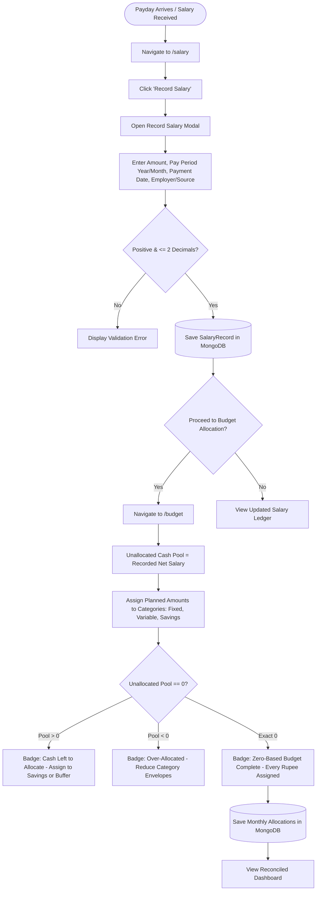
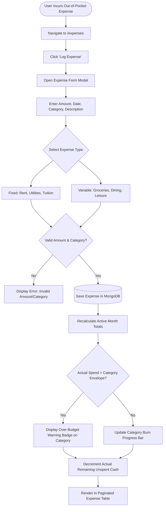
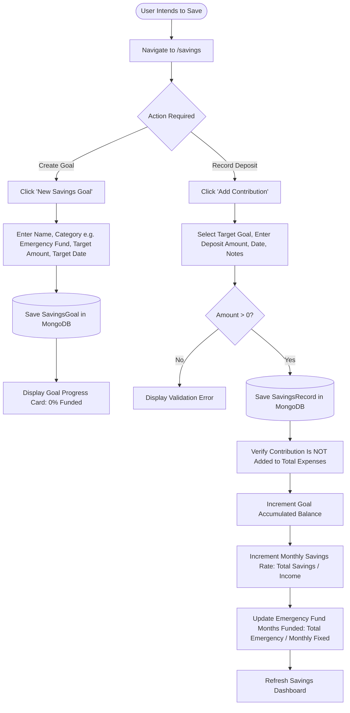
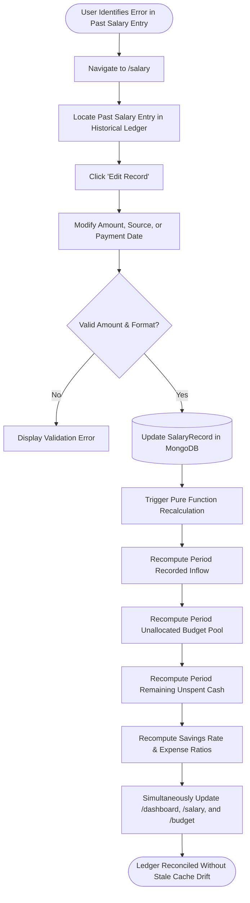
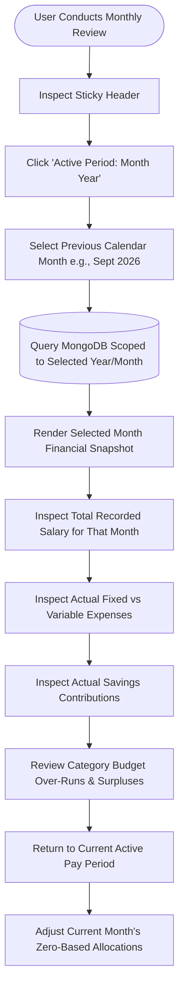

# FINTRACK — PHASE 2: INFORMATION ARCHITECTURE & USER FLOWS

**Project:** Fintrack (Personal Salary & Wealth Management Web Application)  
**Roles:** Senior Product Engineer, Software Architect, UI/UX Designer, Business Analyst  
**Workflow Stage:** Phase 2 — Information Architecture & User Flows  
**Status:** **PHASE 2 STATUS: COMPLETE**  
**Document Version:** 1.0.0 (Approved Baseline)  
**Date:** October 2026  

---

## 1. Executive Summary & Architectural Principles

Phase 2 translates the product requirements, accounting boundaries, and confirmed engineering decisions established in Phase 1 into a coherent, structured **Information Architecture (IA)** and comprehensive **User Flow Diagrams**.

### 1.1 Grounded Architecture Baseline
Following the strict decisions approved in Phase 1:
1. **Salary-First Cash Flow:** Every navigation hierarchy and user journey originates from or reconciles back to the **recorded monthly salary inflow**.
2. **Zero-Based Budgeting (ZBB) First-Class Integration:** The legacy navigation shell ([`components/layout/sidebar.tsx`](file:///c:/1.%20MY%20PROJECTS/SALARY%20MS/fin-track/components/layout/sidebar.tsx)) omitted a dedicated budget route despite ZBB being a core product requirement. Phase 2 formalizes `/budget` as a primary navigation destination immediately following `/salary`.
3. **Unified Single Cash Pool:** The IA contains zero screens, modals, or dropdowns for individual bank accounts (HBL, Meezan, cash accounts), bank linking, or internal transfer reconciliations.
4. **Clean Staging (MVP vs. Post-MVP):** The route inventory and navigation structure clearly distinguish MVP core routes (Dashboard, Salary, Budget, Expenses, Savings, Settings) from Post-MVP commitments (Loans, Insurance, Investments, Reports), ensuring zero scope creep during implementation.
5. **Multi-Tenant Route Isolation:** All application routes operate within a protected `(app)` route group guarded by centralized authentication middleware.

---

## 2. Global Sitemap

The application route hierarchy is divided into two root route groups:
1. **Public / Authentication Routes (`(auth)`):** Accessible without credentials; redirects authenticated users to `/dashboard`.
2. **Protected Personal Finance Workspace (`(app)`):** Wrapped by the responsive persistent shell (`AppShell`); requires an active session cookie.

```
FINTRACK ROOT (/)
 │
 ├── [PUBLIC / AUTH]
 │     ├── /login                        ── Login with Email & Password
 │     ├── /register                     ── New User Account Creation
 │     └── /onboarding                   ── First-Time Financial Profile Setup
 │
 └── [PROTECTED APP SHELL: /(app)]
       │
       ├── [CORE CASH FLOW — MVP]
       │     ├── /dashboard              ── Executive Financial Cockpit & Health Ratios
       │     ├── /salary                 ── Salary Records, Inflow History & Sources
       │     ├── /budget                 ── Zero-Based Allocation & Envelope Planning
       │     ├── /expenses               ── Fixed vs. Variable Expenditure Ledger
       │     └── /savings                ── Savings Goals & Dedicated Emergency Reserve
       │
       ├── [BALANCE SHEET COMMITMENTS — Post-MVP]
       │     ├── /loans                  ── Debt Obligations & EMI Tracking (Post-MVP)
       │     ├── /insurance              ── Protection Policies & Premium Schedules (Post-MVP)
       │     └── /investments            ── Capital Deployed & Asset Registry (Post-MVP)
       │
       └── [ANALYSIS & CONFIGURATION]
             ├── /reports                ── Multi-Month Trend Analytics (Post-MVP)
             └── /settings               ── Profile, Currency & Account Preferences (MVP)
```

---

## 3. Comprehensive Route Inventory

| Route Path | Layout Group | Access Level | Target Stage | Purpose & Screen Title | Data Dependencies & Key State |
| :--- | :--- | :--- | :--- | :--- | :--- |
| `/` | Root | Public | MVP | Root Redirection | Redirects authenticated sessions to `/dashboard`, unauthenticated to `/login`. |
| `/login` | `(auth)` | Public (Guest) | MVP | Sign In | Email & password form; credentials validation via Auth.js. |
| `/register` | `(auth)` | Public (Guest) | MVP | Sign Up | Account registration; creates `User` document; forwards to `/onboarding`. |
| `/onboarding` | `(auth)` | Authenticated | MVP | Initial Profile Setup | Base currency selector (PKR default), estimated monthly income, emergency fund months. |
| `/dashboard` | `(app)` | Authenticated | MVP | Financial Dashboard | Monthly cash snapshot: recorded salary, fixed/variable spend, savings rate, remaining cash. |
| `/salary` | `(app)` | Authenticated | MVP | Salary & Income | List of salary entries, add/edit salary modal, pay period selector, income stream badges. |
| `/budget` | `(app)` | Authenticated | MVP | Zero-Based Budget | Category envelope allocation form, unallocated pool counter (`Income - Allocations = 0`). |
| `/expenses` | `(app)` | Authenticated | MVP | Expense Tracker | Paginated expense ledger, fixed/variable toggle, 14 default categories, filter by month/category. |
| `/savings` | `(app)` | Authenticated | MVP | Savings & Reserves | Emergency fund runway counter, goal creation modal, goal deposit contribution form. |
| `/settings` | `(app)` | Authenticated | MVP | Preferences & Config | Base currency configuration, income target update, profile details, sign-out button. |
| `/loans` | `(app)` | Authenticated | Post-MVP | Loans & Liabilities | Debt register, outstanding balance, monthly EMI burden indicator. |
| `/insurance` | `(app)` | Authenticated | Post-MVP | Insurance Policies | Policy registry, annual premium burden ratio, renewal date tracker. |
| `/investments` | `(app)` | Authenticated | Post-MVP | Investment Assets | Asset registry (funds, equities, gold, real estate), capital deployed tracker. |
| `/reports` | `(app)` | Authenticated | Post-MVP | Financial Reports | 6-to-12-month trend charts, expense distribution breakdowns, historical savings rates. |

---

## 4. Navigation Hierarchy & Shell Architecture

The persistent application layout ([`components/layout/app-shell.tsx`](file:///c:/1.%20MY%20PROJECTS/SALARY%20MS/fin-track/components/layout/app-shell.tsx)) structures user movement through three cohesive UI regions:

### 4.1 Primary Sidebar Navigation (Desktop Fixed, Mobile Drawer)
The sidebar organizes application modules into logical operational groupings:

```
[ BRAND HEADER ]
  ├── Fintrack Logo & Wordmark ("Salary & Wealth")
  └── Mobile Drawer Dismiss Button (Mobile viewport only)

[ GROUP 1: CASH FLOW MANAGEMENT (MVP Core) ]
  ├── Dashboard       (Icon: LayoutDashboard, href: /dashboard)
  ├── Salary          (Icon: Wallet,          href: /salary)
  ├── Budget          (Icon: Calculator/Pie,  href: /budget)  <-- Added for ZBB
  ├── Expenses        (Icon: Receipt,         href: /expenses)
  └── Savings         (Icon: PiggyBank,       href: /savings)

[ GROUP 2: BALANCE SHEET COMMITMENTS (Post-MVP Staged) ]
  ├── Loans           (Icon: CreditCard,      href: /loans)        [Badge: "Later"]
  ├── Insurance       (Icon: ShieldCheck,     href: /insurance)    [Badge: "Later"]
  └── Investments     (Icon: TrendingUp,      href: /investments)  [Badge: "Later"]

[ GROUP 3: ANALYSIS & CONFIGURATION ]
  ├── Reports         (Icon: BarChart3,       href: /reports)      [Post-MVP]
  └── Settings        (Icon: Settings,        href: /settings)     [MVP]

[ USER FOOTER ]
  ├── User Avatar & Initials
  ├── User Display Name
  └── Base Currency & Plan Badge ("PKR · Personal Plan")
```

### 4.2 Top Sticky Header ([`components/layout/header.tsx`](file:///c:/1.%20MY%20PROJECTS/SALARY%20MS/fin-track/components/layout/header.tsx))
- **Left Region:** Mobile hamburger menu trigger; dynamic hierarchical breadcrumbs (`Section / Page Title`).
- **Right Region:**
  - **Active Pay Period Switcher / Badge:** Interactive selector displaying the currently viewed calendar month (`Active Period: October 2026`). Enables instantaneous back-and-forth historical inspection.
  - **Notifications Trigger:** Bell icon with visual unread indicator (deferred to Post-MVP).
  - **User Profile Menu:** Dropdown containing direct link to `/settings` and "Sign Out" action.

---

## 5. Detailed User Flow Diagrams

### Flow 1: Registration, Authentication & Profile Onboarding
```mermaid
flowchart TD
    Start([User Arrives at /]) --> AuthCheck{Has Active Session?}
    AuthCheck -- Yes --> Dashboard[/dashboard]
    AuthCheck -- No --> Login[/login]

    Login --> HasAccount{Existing Account?}
    HasAccount -- No --> Register[/register]
    HasAccount -- Yes --> SubmitLogin[Submit Email & Password]

    Register --> SubmitRegister[Submit Name, Email & Password]
    SubmitRegister --> CreateUser[(Create User in DB)]
    CreateUser --> Onboarding[/onboarding]

    SubmitLogin --> VerifyCreds{Valid Password?}
    VerifyCreds -- No --> ShowAuthError[Display Error: Invalid Credentials]
    VerifyCreds -- Yes --> IssueCookie[Issue HTTP-Only Session Cookie]
    IssueCookie --> HasProfile{Financial Profile Initialized?}
    HasProfile -- No --> Onboarding
    HasProfile -- Yes --> Dashboard

    Onboarding --> SetCurrency[Select Base Currency: PKR Default]
    SetCurrency --> SetIncomeTarget[Enter Estimated Monthly Net Salary]
    SetIncomeTarget --> SetEmergencyMonths[Set Emergency Cushion: 6 Months]
    SetEmergencyMonths --> SaveProfile[(Save FinancialProfile in DB)]
    SaveProfile --> Dashboard
```

---

### Flow 2: Monthly Salary Inflow & Zero-Based Budget Allocation


---

### Flow 3: Daily Expense Logging & Budget Burn


---

### Flow 4: Savings Goal Creation & Contribution


---

### Flow 5: Salary Revision / Correction & Aggregate Reconciliation


---

### Flow 6: Month-End Historical Review & Pay Period Navigation


---

## 6. Screen-Level Information Architecture & State Contracts

### 6.1 Authentication Screens
#### Route: `/login`
- **Data Inputs:** Email address (`type="email"`), Password (`type="password"`).
- **Actions:** "Sign In" button, "Create an Account" text link, "Forgot password" link (Post-MVP).
- **Error States:** Invalid credentials banner, rate-limiting lockout warning, server unreachable alert.

#### Route: `/register`
- **Data Inputs:** Full Name, Email, Password, Password Confirmation.
- **Actions:** "Create Account" button, "Already have an account? Sign In" link.
- **Validation:** Minimum 8 characters, password confirmation match, unique email check.

#### Route: `/onboarding`
- **Data Inputs:**
  - Base Currency dropdown (PKR pre-selected; options: USD, EUR, GBP, AED, SAR).
  - Target Monthly Net Salary (numeric currency input).
  - Target Emergency Fund Cushion (selector: 3, 6, 9, 12 months; default: 6).
- **Actions:** "Complete Setup & Launch Dashboard" button.

---

### 6.2 Executive Dashboard (`/dashboard`)
- **Header Context:** Active pay period indicator, quick period navigation, greeting, quick-action "Log Expense" button.
- **Top Metric Cards (KPI Band):**
  1. **Recorded Net Salary:** Total recorded inflow for the period; badge indicating stream count.
  2. **Total Expenses:** Cumulative actual spending; broken down into sub-indicators for Fixed vs. Variable.
  3. **Total Savings:** Cumulative deposits into savings goals; does not include general unspent cash.
  4. **Remaining Unspent Cash:** `Net Salary - (Total Expenses + Total Savings)`. Color-coded (Emerald if positive, Rose if deficit).
- **Health Ratios Band:**
  - **Savings Rate Gauge:** $\frac{\text{Actual Savings}}{\text{Recorded Salary}} \times 100$ (Target: >= 20%).
  - **Expense Ratio Gauge:** $\frac{\text{Actual Expenses}}{\text{Recorded Salary}} \times 100$ (Target: <= 60%).
  - **Fixed Overhead Burden:** $\frac{\text{Fixed Expenses}}{\text{Recorded Salary}} \times 100$ (Indicates non-negotiable living baseline).
- **Secondary Widgets:**
  - **Budget Envelope Burn Overview:** Top 5 consuming categories vs. allocated limits.
  - **Emergency Fund Progress Teaser:** Current funded months vs. target (e.g., "3.8 of 6.0 Months Funded").
  - **Recent Transactions Ledger:** 5 most recent expense entries with quick link to `/expenses`.

---

### 6.3 Salary Management (`/salary`)
- **Header:** Title "Salary & Income", period badge, primary action button "Record Salary".
- **Summary Cards:** Total Monthly Recorded Income, Primary Salary Amount, Secondary/Bonus Inflow.
- **Record Salary Modal / Form:**
  - Amount (monetary number, strictly positive, max 2 decimals).
  - Currency (disabled, locked to profile base currency).
  - Salary Type dropdown (`Primary`, `Secondary`, `Bonus`, `Allowance`, `Freelance`, `Other`).
  - Pay Period Month (1–12) & Pay Period Year (e.g., 2026).
  - Payment Date (date picker).
  - Employer / Income Source (text input, max 150 chars).
  - Notes (textarea, optional).
- **Salary History Table:**
  - Columns: Payment Date, Pay Period, Source, Stream Type (badge), Amount, Actions (Edit, Delete).
  - Pagination bar (20 records per page).

---

### 6.4 Zero-Based Budgeting (`/budget`)
- **Header:** Title "Zero-Based Budget Allocation", period switcher.
- **ZBB Summary Banner (The Equalizer):**
  - **Recorded Inflow:** e.g., `₨ 300,000`
  - **Minus Total Allocated:** `₨ 300,000`
  - **Equals Unallocated Pool:** `₨ 0` (Visual state: Green checkmark badge "Zero-Based Budget Balanced!").
  - *Deficit State:* If allocated > salary, banner turns Amber/Rose: `"Over-allocated by ₨ 15,000"`.
- **Category Allocation Grid:**
  - Grouped into **Fixed Commitments** (Housing, Utilities, Tuition), **Variable Categories** (Groceries, Dining, Apparel), and **Savings Envelopes** (Emergency Reserve, Down Payment).
  - Per Category Row:
    - Category Icon & Label.
    - Envelope Input (planned numeric amount).
    - Actual Spend to Date (real-time sum of matching expenses).
    - Variance Indicator (Remaining envelope cash, progress bar, over-budget alert if consumed > 100%).
- **Actions:** "Save Allocation Plan", "Reset to Previous Month", "Auto-Allocate All Remaining to Emergency Fund".

---

### 6.5 Expense Management (`/expenses`)
- **Header:** Title "Expense Tracker", period badge, primary action button "Log Expense".
- **Summary Cards:** Total Monthly Spend, Fixed Living Costs total, Variable Discretionary total.
- **Log Expense Modal / Form:**
  - Amount (numeric, strictly positive, max 2 decimals).
  - Expense Classification (radio/pill toggle: `Fixed` vs. `Variable`).
  - Category dropdown (14 pre-seeded categories with icons).
  - Expense Date (defaults to today).
  - Description (text input, max 255 chars, e.g., "Al-Fatah Monthly Groceries").
  - Notes (textarea, optional).
- **Filter Toolbar:** Filter by Category dropdown, Filter by Type (`All`, `Fixed`, `Variable`), Search description input.
- **Expenses Ledger Table:**
  - Columns: Date, Description, Category (with icon), Type (`Fixed`/`Variable` badge), Amount, Actions (Edit, Delete).
  - Pagination bar (default 20/page).

---

### 6.6 Savings & Emergency Reserves (`/savings`)
- **Header:** Title "Savings & Cash Reserves", primary action button "New Savings Goal", secondary action "Record Deposit".
- **Emergency Reserve Showcase Card:**
  - Target Months indicator (e.g. "6 Months Living Expenses Target").
  - Calculated Monthly Fixed Baseline (derived automatically from fixed expenses/allocations).
  - Target Emergency Fund Value (e.g. `₨ 180,000/mo * 6 = ₨ 1,080,000`).
  - Current Accumulated Cash Cushion (e.g. `₨ 720,000` — 66.7% Funded, 4.0 Months Runway).
- **Savings Goals Grid:**
  - Goal cards for active goals (Emergency Fund, Wedding, House Down Payment, Vacation).
  - Displays: Target Amount, Accumulated Balance, Target Date, Visual Progress Ring/Bar.
  - Quick action: "Contribute Cash".
- **Record Contribution Modal:**
  - Target Goal selector (dropdown of user's active goals).
  - Amount saved.
  - Date of deposit.
  - Notes.
  - Explicit notification text: *"Savings deposits increment your goal balance and savings rate. They are never counted as expenses."*
- **Recent Contributions Ledger:**
  - Chronological audit of all past savings deposits.

---

### 6.7 User Settings & Preferences (`/settings`)
- **Profile Preferences:**
  - Full Name, Email address (read-only in MVP).
  - Default Currency selector (PKR, USD, EUR, GBP, AED, SAR).
  - Target Monthly Net Income.
  - Emergency Fund Target Horizon (3–12 months).
- **Data & Privacy Management:**
  - "Clear Historical Data" (requires explicit confirmation modal with password re-entry).
- **Session Controls:**
  - "Sign Out of All Devices" action button.

---

## 7. Role-Based Access Control (RBAC) & Route Protection Matrix

Because Fintrack is a private personal finance tool, roles are strictly partitioned between **Anonymous Guests** and **Authenticated Ledger Owners**.

| Route Path | Unauthenticated User (`GUEST`) | Authenticated User (`USER`) | Handling on Invalid / Expired Session |
| :--- | :--- | :--- | :--- |
| `/` | Redirect to `/login` | Redirect to `/dashboard` | Redirect to `/login` |
| `/login` | Allowed (Renders login form) | Redirect to `/dashboard` | Allowed |
| `/register` | Allowed (Renders register form) | Redirect to `/dashboard` | Allowed |
| `/onboarding` | Redirect to `/login` | Allowed | Redirect to `/login` |
| `/dashboard` | Redirect to `/login` | Allowed (Scoped to own `userId`) | Redirect to `/login` with `?from=/dashboard` |
| `/salary` | Redirect to `/login` | Allowed (Scoped to own `userId`) | Redirect to `/login` with `?from=/salary` |
| `/budget` | Redirect to `/login` | Allowed (Scoped to own `userId`) | Redirect to `/login` with `?from=/budget` |
| `/expenses` | Redirect to `/login` | Allowed (Scoped to own `userId`) | Redirect to `/login` with `?from=/expenses` |
| `/savings` | Redirect to `/login` | Allowed (Scoped to own `userId`) | Redirect to `/login` with `?from=/savings` |
| `/settings` | Redirect to `/login` | Allowed (Scoped to own `userId`) | Redirect to `/login` with `?from=/settings` |
| `/loans` | Redirect to `/login` | Allowed (Post-MVP feature flag) | Redirect to `/login` |
| `/insurance` | Redirect to `/login` | Allowed (Post-MVP feature flag) | Redirect to `/login` |
| `/investments`| Redirect to `/login` | Allowed (Post-MVP feature flag) | Redirect to `/login` |
| `/reports` | Redirect to `/login` | Allowed (Post-MVP feature flag) | Redirect to `/login` |

### Tenant Access Invariant:
Attempting to fetch a document using a URL parameter belonging to another user (e.g., requesting an expense ID belonging to User B while logged in as User A) must fail with a `RecordNotFoundError` (HTTP 404). The application will never disclose whether an ID exists for another user.

---

## 8. Information Architecture Risk Assessment & Mitigations

| IA Risk ID | Description & Potential Impact | Mitigation in Phase 2 Architecture |
| :--- | :--- | :--- |
| **IA-RSK-01** | **Conflation of Budget with Actual Outflows:** Users might assume that setting a category allocation deducts real money from their cash pool. | Clearly delineate `/budget` as a forward-looking plan with prominent labels: *"Planned Allocation (Plan)"* vs. `/expenses` as *"Actual Expenditures (Reality)"*. |
| **IA-RSK-02** | **Omission of ZBB from Navigation:** In the legacy layout, no budget route existed, leading users to believe the app was a simple expense tracker. | Established `/budget` as a primary navigation item directly adjacent to `/salary` in both desktop sidebar and mobile drawer. |
| **IA-RSK-03** | **Navigation Clutter from Post-MVP Routes:** Presenting non-functional routes (Loans, Insurance, Investments) confuses users during MVP. | Post-MVP items are isolated into a separate "Balance Sheet Commitments" group in the IA and marked with visual "Later" badges until Phase 7. |
| **IA-RSK-04** | **Pay Period Confusion across Routes:** Navigating from `/dashboard` (October) to `/expenses` might reset the view to all-time, causing cognitive mismatch. | Pay period state (`periodYear`, `periodMonth`) is centralized in the sticky header context and propagated consistently across all ledger views. |
| **IA-RSK-05** | **Mobile Data Density Overload:** Financial tables with 6+ columns cause horizontal scroll breakage on 360px mobile viewports. | Designed responsive card-based summaries for mobile viewports, reserving multi-column tables for desktop screens >= 768px. |

---

## 9. Phase 2 Checklist

- [x] Complete global sitemap (Public vs. Protected, MVP vs. Post-MVP)
- [x] Comprehensive route inventory with layout groups, parameters, and access levels
- [x] Navigation hierarchy (Desktop fixed sidebar, sticky header, mobile drawer)
- [x] Integration of Zero-Based Budgeting (`/budget`) into primary navigation
- [x] Complete Mermaid user-flow diagrams (Onboarding, Salary & ZBB, Expense logging, Savings goal & deposit, Salary correction, Month-end review)
- [x] Screen-level Information Architecture & state contracts for all MVP routes
- [x] Role-Based Access Control (RBAC) and tenant protection matrix
- [x] Information Architecture risk assessment and mitigations

---

## 10. Phase 2 Gate Decision

### PHASE 2 STATUS: COMPLETE

**Justification:**  
The Information Architecture, route inventory, navigation hierarchy, user flows, and screen-level state contracts are fully specified and aligned with the approved Phase 1 discovery requirements. No application code, database schemas, or UI implementations were modified during this phase.

---

## 11. Recommended Next Action

Next step: **Phase 3 — Wireframes & UI/UX Design.**
