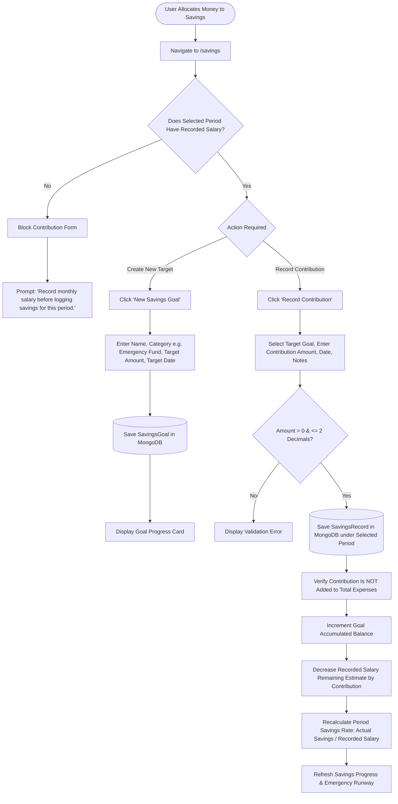
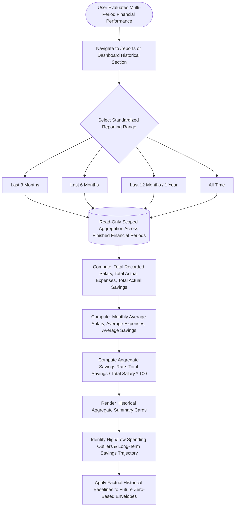

# FINTRACK — PHASE 2: INFORMATION ARCHITECTURE & USER FLOWS

**Project:** Fintrack (Personal Salary & Wealth Management Web Application)  
**Roles:** Senior Product Engineer, Software Architect, UI/UX Designer, Business Analyst  
**Workflow Stage:** Phase 2 — Information Architecture & User Flows  
**Status:** **PHASE 2 STATUS: COMPLETE** (Approved Baseline — Financial Period Model Aligned with Phase 1 v2.0.0)  
**Document Version:** 2.0.0 (Canonical Baseline — Phase 2 Complete)  
**Date:** October 2026  

---

## 1. Executive Summary & Architectural Principles

Phase 2 translates the product requirements, foundational accounting boundaries, and confirmed engineering decisions established in Phase 1 (v2.0.0) into a coherent, structured **Information Architecture (IA)** and comprehensive **User Flow Diagrams**.

### 1.1 The Core Product Flow
Fintrack organizes the personal financial planning lifecycle around an unambiguous, sequential flow:

$$\text{Select Financial Period} \longrightarrow \text{Record Primary Salary} \longrightarrow \text{Manage Expenses / Savings} \longrightarrow \text{Review Period}$$

### 1.2 Grounded Architectural Principles
Following the approved Phase 1 canonical baseline:
1. **Financial Period as the Authoritative Monthly Boundary:** The core monthly organizing unit is the **Financial Period**, representing one user-selected calendar month (e.g., *October 2026*, *November 2026*). The user explicitly selects the calendar month when recording salary, which activates that period. The application associates all monthly financial records with that explicitly selected Financial Period and **never silently guesses or infers the period from transaction or payment dates**.
2. **Sequential Monthly Record Gating:** To eliminate "missing salary but existing expenses" ambiguities in normal user flows, the application strictly enforces:
   $$\text{Financial Period} \longrightarrow \text{Recorded Salary} \longrightarrow \text{Expenses / Savings}$$
   A user must select a calendar month and record its primary salary before monthly expenses or savings contributions can be entered. The normal UI prevents creating expenses or savings for a month without an active Financial Period with recorded salary.
3. **Monthly Independence & Isolated Historical Revision:** Every Financial Period is an independent monthly record. Changing October 2026 never directly modifies November 2026. Users can return to any historical Financial Period and edit its records; recomputation updates only that period's snapshot and cross-period aggregates recomputed from raw records, leaving other periods untouched.
4. **Zero-Based Budgeting (ZBB) First-Class Integration:** Phase 2 formalizes `/budget` as a primary navigation destination immediately following `/salary`. Planned allocations in `/budget` are forward-looking spending intentions partitioned against the **Unallocated Budget Pool** (`Recorded Salary - Planned Allocations = 0`), strictly decoupled from actual cash movements.
5. **MVP Calculation Kernel & Excess Outflow Presentation:** The MVP calculation kernel is strictly:
   $$\text{Recorded Salary Remaining (Estimate)} = \text{Recorded Salary} - \text{Actual Expenses} - \text{Actual Savings}$$
   When cumulative outflows exceed recorded salary, internal math preserves the signed calculation for correctness, but the primary user-facing estimate displays `PKR 0` alongside an explicit warning banner showing the excess outflow amount. Balance sheet modules (Loans, Insurance, Investments) remain Post-MVP and are excluded from the kernel.
6. **Dual-Responsibility Dashboard Architecture:** The dashboard maintains a strict conceptual separation between:
   - **Selected Financial Period Summary:** Metrics strictly belonging to the currently selected month (`Financial Period: October 2026`).
   - **Historical / Aggregate Analysis:** Cross-period analysis across predefined reporting ranges (**Last 3 Months, Last 6 Months, Last 12 Months / 1 Year, All Time**).
7. **Strict Terminology Discipline:** The IA and UI flows strictly adhere to manual personal-finance recording concepts (Recorded Salary, Financial Period, Unallocated Budget Pool, Recorded Salary Remaining Estimate). All banking and liquidity terms ("Bank Balance", "Cash Pool", "Verified Cash", "Salary Received", "Guaranteed Available to Spend") are strictly prohibited.
8. **Multi-Tenant Route Isolation (Requirement):** All protected personal finance routes operate within the `(app)` route group, strictly guarded by server-side authorization and tenant isolation scoped by `userId`.

---

## 2. Global Sitemap

The application route hierarchy is divided into two root route groups:
1. **Public / Authentication Routes (`(auth)`):** Accessible without credentials; redirects authenticated sessions to `/dashboard`.
2. **Protected Personal Finance Workspace (`(app)`):** Wrapped by the responsive persistent shell (`AppShell`); requires an active session cookie and enforces tenant isolation.

```
FINTRACK ROOT (/)
 │
 ├── [PUBLIC / AUTH]
 │     ├── /login                        ── Login with Email & Password
 │     ├── /register                     ── New User Account Creation
 │     └── /onboarding                   ── First-Time Financial Profile Setup (Base Currency: PKR)
 │
 └── [PROTECTED APP SHELL: /(app)]
       │
       ├── [CORE CASH FLOW & FINANCIAL PERIOD WORKFLOW — MVP Core]
       │     ├── /dashboard              ── Selected Period Snapshot & Cross-Period Historical Aggregates
       │     ├── /salary                 ── Financial Period Activation & Primary Salary Management
       │     ├── /budget                 ── Zero-Based Allocation & Unallocated Budget Pool Planning
       │     ├── /expenses               ── Fixed vs. Variable Expenditure Ledger (Gated by Period Salary)
       │     └── /savings                ── Savings Goals & Dedicated Emergency Reserve (Gated by Period Salary)
       │
       ├── [ANALYSIS & CONFIGURATION]
       │     ├── /reports                ── Multi-Month Historical Aggregates (MVP Core: 3M/6M/12M/All Time; Advanced Post-MVP)
       │     └── /settings               ── Profile, Base Currency & Preferences (MVP)
       │
       └── [BALANCE SHEET COMMITMENTS — Post-MVP Deferred]
             ├── /loans                  ── Debt Obligations & EMI Tracking (Post-MVP)
             ├── /insurance              ── Protection Policies & Premium Schedules (Post-MVP)
             └── /investments            ── Capital Deployed & Asset Registry (Post-MVP)
```

---

## 3. Comprehensive Route Inventory

| Route Path | Layout Group | Access Level | Target Stage | Purpose & Screen Title | Data Dependencies & Financial Period Context |
| :--- | :--- | :--- | :--- | :--- | :--- |
| `/` | Root | Public | MVP | Root Redirection | Redirects authenticated sessions to `/dashboard`, unauthenticated to `/login`. |
| `/login` | `(auth)` | Public (Guest) | MVP | Sign In | Email & password form; credentials validation via Auth.js. |
| `/register` | `(auth)` | Public (Guest) | MVP | Sign Up | Account registration; creates `User` document; forwards to `/onboarding`. |
| `/onboarding` | `(auth)` | Authenticated | MVP | Initial Profile Setup | Base currency selector (mandatory, PKR default), optional non-blocking income target and emergency fund horizon. |
| `/dashboard` | `(app)` | Authenticated | MVP | Executive Financial Dashboard | **Two distinct responsibilities:** <br>1. *Selected Financial Period Summary:* Contextual to user-selected month (e.g. Oct 2026); shows Recorded Salary, Actual Expenses, Actual Savings, and Recorded Salary Remaining Estimate (PKR 0 + Warning if outflows > salary). <br>2. *Historical Aggregate Analysis:* Predefined reporting ranges (Last 3M, 6M, 12M, All Time) with core metrics. |
| `/salary` | `(app)` | Authenticated | MVP | Salary & Period Activation | Calendar month selector for Financial Period activation; record primary monthly net salary; view historical period salary ledger. |
| `/budget` | `(app)` | Authenticated | MVP | Zero-Based Budget | Category envelope allocation scoped to selected Financial Period; unallocated budget pool equalizer (`Recorded Salary - Planned Allocations = 0`). |
| `/expenses` | `(app)` | Authenticated | MVP | Expense Tracker | Paginated expense ledger for selected Financial Period; fixed/variable classification; 14 categories. **Gated:** Normal UI blocks expense entry if selected month lacks recorded salary. |
| `/savings` | `(app)` | Authenticated | MVP | Savings & Reserves | Emergency fund runway counter, goal creation, and contribution logging. **Gated:** Normal UI blocks contributions if selected month lacks recorded salary. Contributions are strictly non-expense accounting. |
| `/reports` | `(app)` | Authenticated | MVP (Core) / Post-MVP (Visuals) | Historical Reports | **Core MVP:** Multi-period aggregate summaries across Last 3M, Last 6M, Last 12M, and All Time (Totals, Monthly Averages, Aggregate Savings Rate). <br>**Post-MVP:** Advanced trend charts, distribution graphs, and CSV multi-tab export. |
| `/settings` | `(app)` | Authenticated | MVP | Preferences & Config | Base currency configuration, income target updates, profile details, sign-out button. |
| `/loans` | `(app)` | Authenticated | Post-MVP | Loans & Liabilities | Debt register, outstanding balance, monthly EMI burden indicator. |
| `/insurance` | `(app)` | Authenticated | Post-MVP | Insurance Policies | Policy registry, annual premium burden ratio, renewal date tracker. |
| `/investments` | `(app)` | Authenticated | Post-MVP | Investment Assets | Asset registry (funds, equities, gold, real estate), capital deployed tracker. |

---

## 4. Navigation Hierarchy & Shell Architecture

The persistent application layout ([`components/layout/app-shell.tsx`](file:///c:/1.%20MY%20PROJECTS/SALARY%20MS/fin-track/components/layout/app-shell.tsx)) structures user movement through three cohesive UI regions:

### 4.1 Primary Sidebar Navigation (Desktop Fixed, Mobile Drawer)
The sidebar organizes application modules into logical operational groupings:

```
[ BRAND HEADER ]
  ├── Fintrack Logo & Wordmark ("Salary & Wealth")
  └── Mobile Drawer Dismiss Button (Mobile viewport only)

[ GROUP 1: MONTHLY CASH FLOW & BUDGETING (MVP Core) ]
  ├── Dashboard       (Icon: LayoutDashboard, href: /dashboard)
  ├── Salary          (Icon: Wallet,          href: /salary)
  ├── Budget          (Icon: Calculator/Pie,  href: /budget)
  ├── Expenses        (Icon: Receipt,         href: /expenses)
  └── Savings         (Icon: PiggyBank,       href: /savings)

[ GROUP 2: ANALYSIS & CONFIGURATION ]
  ├── Reports         (Icon: BarChart3,       href: /reports)   [Core Aggregates: MVP / Charts: Post-MVP]
  └── Settings        (Icon: Settings,        href: /settings)  [MVP]

[ GROUP 3: BALANCE SHEET COMMITMENTS (Post-MVP Staged) ]
  ├── Loans           (Icon: CreditCard,      href: /loans)        [Badge: "Later"]
  ├── Insurance       (Icon: ShieldCheck,     href: /insurance)    [Badge: "Later"]
  └── Investments     (Icon: TrendingUp,      href: /investments)  [Badge: "Later"]

[ USER FOOTER ]
  ├── User Avatar & Initials
  ├── User Display Name
  └── Base Currency Badge ("PKR · Personal Plan")
```

### 4.2 Top Sticky Header & Financial Period Navigation Model ([`components/layout/header.tsx`](file:///c:/1.%20MY%20PROJECTS/SALARY%20MS/fin-track/components/layout/header.tsx))
The sticky header houses the global context engine of the application:
- **Left Region:** Mobile drawer trigger; dynamic hierarchical breadcrumbs (`Section / Current View`).
- **Right Region:**
  - **The Financial Period Navigation Selector:** The authoritative period context control.
    $$\text{Financial Period } [\text{ October 2026 } \blacktriangledown]$$
  - **Notifications Trigger:** Bell icon with visual indicator (deferred to Post-MVP).
  - **User Profile Menu:** Dropdown containing direct link to `/settings` and "Sign Out" action.

#### The Financial Period Navigation Model
The Financial Period selector in the header is the central contextual anchor for all monthly workflows:
1. **Unambiguous Period Visibility:** The user immediately sees which calendar month is currently active (e.g., `Financial Period: October 2026`). Every financial metric, transaction table, budget envelope, and remaining estimate rendered on `/dashboard`, `/salary`, `/budget`, `/expenses`, and `/savings` belongs strictly to this selected period.
2. **Switching Between Active Periods:** Clicking the selector opens a dropdown listing all activated Financial Periods. Selecting an existing period (e.g., `September 2026`) instantaneously switches the viewing context across all cash flow screens. Switching is strictly read-only navigation and never mutates underlying documents.
3. **Activating a New Financial Period (`+ Activate New Period`):** The selector dropdown provides a direct creation trigger. Selecting `+ Activate New Period` guides the user through the primary monthly activation flow:
   - User selects an unactivated calendar month (e.g., `November 2026`).
   - User is presented with the primary salary entry form.
   - Recording the salary activates the November 2026 Financial Period and sets it as the active context.
4. **Historical Inspection & Independent Editing:** Users can freely navigate to any historical Financial Period. The UI displays an explicit indicator that a historical period is being viewed. The user can edit historical salary, expenses, or savings belonging to that period. Upon saving:
   - That historical period's calculations and summary update immediately.
   - Cross-period aggregate analytics (Last 3M, 6M, 12M, All Time) are recalculated from raw documents upon request.
   - All other Financial Periods remain completely isolated and unaffected.
5. **No Automated Guessing from Transaction Dates:** The selected Financial Period is authoritative. If an expense is logged with a transaction date of `October 30, 2026`, but the user has explicitly selected `November 2026` as the target Financial Period, the application associates the record with the selected Financial Period. The system never overrides or infers period boundaries from dates.
6. **Strict Separation: Selected Period Context vs. Historical Reporting Ranges:**
   - **Selected Period Context:** Scoped to a single, specific calendar month (e.g., *October 2026*). Governs daily cash flow operations, envelope burning, and period reconciliation.
   - **Historical Reporting Ranges:** Scoped to multi-period aggregate windows (e.g., *Last 6 Months*). Managed within `/reports` or the dashboard historical analysis section, completely decoupled from single-month cash flow logging.

---

## 5. Detailed User Flow Diagrams

### Flow 1: Registration, Authentication & Profile Onboarding
```mermaid
flowchart TD
    Start([User Arrives at /]) --> AuthCheck{Has Active Session?}
    AuthCheck -- Yes --> Dashboard[/dashboard]
    AuthCheck -- No --> Login[/login]

    Login --> HasAccount{Existing Account?}
    HasAccount -- No --> Register[/register]
    HasAccount -- Yes --> SubmitLogin[Submit Email & Password]

    Register --> SubmitRegister[Submit Name, Email & Password]
    SubmitRegister --> CreateUser[(Create User in DB)]
    CreateUser --> Onboarding[/onboarding]

    SubmitLogin --> VerifyCreds{Valid Password?}
    VerifyCreds -- No --> ShowAuthError[Display Error: Invalid Credentials]
    VerifyCreds -- Yes --> IssueCookie[Issue HTTP-Only Session Cookie]
    IssueCookie --> HasProfile{Financial Profile Initialized?}
    HasProfile -- No --> Onboarding
    HasProfile -- Yes --> Dashboard

    Onboarding --> SetCurrency[Select Base Currency: PKR Default (Mandatory)]
    SetCurrency --> SetOptionalDefaults[Configure Optional Profile Defaults: Estimated Income & Emergency Cushion]
    SetOptionalDefaults --> SaveProfile[(Save FinancialProfile in DB)]
    SaveProfile --> PromptFirstPeriod[Prompt: Activate Initial Financial Period]
    PromptFirstPeriod --> Dashboard
```

---

### Flow 2: Financial Period Creation & Zero-Based Allocation (Journeys A & D)
```mermaid
flowchart TD
    StartPeriod([User Initiates Monthly Financial Setup]) --> SelectMonth[Select Calendar Month e.g., October 2026]
    SelectMonth --> CheckPeriodExists{Period Already Exists?}
    
    CheckPeriodExists -- Yes --> SwitchContext[Switch Active Context to October 2026]
    CheckPeriodExists -- No --> OpenSalaryEntry[Open Primary Salary Entry Form]

    OpenSalaryEntry --> FillSalary[Enter Primary Net Salary Amount & Source]
    FillSalary --> ValidateSalary{Positive Amount & <= 2 Decimals?}
    ValidateSalary -- No --> ShowSalaryError[Display Validation Error]
    ValidateSalary -- Yes --> PersistPeriod[(Save Primary Salary & Activate Financial Period in MongoDB)]

    PersistPeriod --> ActivateContext[Set Active Context: Financial Period = October 2026]
    ActivateContext --> PromptAction{Next Action}

    PromptAction -- Allocate Zero-Based Budget --> OpenBudget[/budget]
    PromptAction -- View Selected Dashboard --> OpenDashboard[/dashboard]

    OpenBudget --> CalculatePool[Unallocated Budget Pool = Recorded Primary Salary]
    CalculatePool --> AssignEnvelopes[Assign Planned Envelope Limits: Fixed, Variable, Savings]
    AssignEnvelopes --> EvaluatePool{Unallocated Pool == 0?}
    
    EvaluatePool -- Pool > 0 --> ShowSurplusAlert[Badge: Unallocated Budget Remaining - Assign to Planned Envelopes]
    EvaluatePool -- Pool < 0 --> ShowDeficitAlert[Badge: Over-Allocated - Reduce Planned Envelopes]
    EvaluatePool -- Exact 0 --> ShowZeroSuccess[Badge: Zero-Based Budget Balanced - Every Rupee Planned]
    
    ShowZeroSuccess --> PersistBudget[(Save Monthly Allocations in MongoDB)]
    PersistBudget --> OpenDashboard

    OpenDashboard --> RenderSummary[Render October 2026 Period Summary: Salary, Expenses, Savings, Remaining]
```

---

### Flow 3: Gated Daily Expense Logging & Budget Burn (Journey B)
```mermaid
flowchart TD
    Spend([User Incurs Outflow]) --> TriggerExpense[Click 'Log Expense' on Dashboard or /expenses]
    TriggerExpense --> VerifyPeriodGating{Does Selected Period Have Recorded Salary?}

    VerifyPeriodGating -- No --> BlockEntry[Block Form: Show Gating Alert]
    BlockEntry --> PromptSalaryGuide[Banner: 'No recorded salary found for this month. Record salary to activate period.']
    PromptSalaryGuide --> RedirectSalary[/salary]

    VerifyPeriodGating -- Yes --> OpenExpenseModal[Open Expense Form Modal]
    OpenExpenseModal --> InputDetails[Enter Amount, Transaction Date, Category, Description]
    InputDetails --> TagType{Select Classification}
    TagType --> Fixed[Fixed: Rent, Utilities, Tuition]
    TagType --> Variable[Variable: Groceries, Dining, Leisure]

    Fixed & Variable --> ValidateExpense{Valid Positive Amount & Category?}
    ValidateExpense -- No --> ShowExpError[Display Error: Invalid Input]
    ValidateExpense -- Yes --> PersistExpense[(Save Expense in MongoDB under Selected Period)]

    PersistExpense --> RecalculateTotals[Recalculate Selected Period Actual Expenses]
    RecalculateTotals --> EvaluateBurn{Expenses + Savings > Recorded Salary?}

    EvaluateBurn -- Yes (Excess Outflow) --> SetRemainingZero[Set Remaining Estimate Display to PKR 0]
    SetRemainingZero --> TriggerExcessWarning[Display Warning Banner: 'Expenses and savings exceed recorded salary by PKR X']

    EvaluateBurn -- No (Within Salary) --> CalcStandardRemaining[Recorded Salary Remaining = Salary - Expenses - Savings]
    CalcStandardRemaining --> UpdateBudgetBars[Update Category Envelope Burn Progress Bars]

    TriggerExcessWarning & UpdateBudgetBars --> RefreshLedgers[Update Dashboard & Paginated Expense Ledger]
```

---

### Flow 4: Gated Savings Goal Contribution & Reserve Funding (Journey C)


---

### Flow 5: Financial Period Revision & Isolated Historical Recalculation (Journey E)
```mermaid
flowchart TD
    Revision([User Needs to Correct Historical Record]) --> OpenHeader[Inspect Sticky Header Period Selector]
    OpenHeader --> ClickPeriodDropdown[Click 'Financial Period [ October 2026 ▼ ]']
    ClickPeriodDropdown --> SelectPriorPeriod[Select Completed Historical Period e.g., September 2026]

    SelectPriorPeriod --> SwitchPeriodContext[Context Switches to September 2026 (Historical View Banner)]
    SwitchPeriodContext --> ChooseEntity{Select Record to Edit}

    ChooseEntity -- Edit Primary Salary --> EditSalaryRecord[Modify September Salary Amount]
    ChooseEntity -- Edit Past Expense --> EditExpenseRecord[Modify September Expense Amount/Category]
    ChooseEntity -- Edit Savings Contribution --> EditSavingsRecord[Modify September Savings Deposit]

    EditSalaryRecord & EditExpenseRecord & EditSavingsRecord --> ValidateEdit{Valid Monetary Format?}
    ValidateEdit -- No --> ShowEditError[Display Validation Error]
    ValidateEdit -- Yes --> UpdateRecordDB[(Update Selected Record in MongoDB)]

    UpdateRecordDB --> TriggerIsolatedRecalc[Trigger Pure Deterministic Functions for September 2026 ONLY]
    TriggerIsolatedRecalc --> RecalcPeriodSnapshot[Recalculate September Snapshot: Salary, Outflows, Remaining, Ratios]
    RecalcPeriodSnapshot --> VerifyIsolation[Confirm October & November Periods Remain 100% Unchanged]

    VerifyIsolation --> TriggerAggregateRecalc[Recalculate Cross-Period Historical Aggregates from Raw Records]
    TriggerAggregateRecalc --> ReconcileViews[Refresh September View & Historical Reporting Aggregates]
```

---

### Flow 6: Cross-Period Historical Analytics & Reporting Audit (Journey F)


---

## 6. Screen-Level Information Architecture & State Contracts

### 6.1 Authentication Screens
#### Route: `/login`
- **Data Inputs:** Email address (`type="email"`), Password (`type="password"`).
- **Actions:** "Sign In" button, "Create an Account" text link, "Forgot password" link (Post-MVP).
- **Error States:** Invalid credentials banner, rate-limiting lockout warning, server unreachable alert.

#### Route: `/register`
- **Data Inputs:** Full Name, Email, Password, Password Confirmation.
- **Actions:** "Create Account" button, "Already have an account? Sign In" link.
- **Validation:** Minimum 8 characters, password confirmation match, unique email check.

#### Route: `/onboarding`
- **Data Inputs:**
  - Base Currency dropdown (**Mandatory**; PKR pre-selected; options: USD, EUR, GBP, AED, SAR).
  - Target Monthly Net Salary (**Optional proposed target**; non-blocking numeric currency input).
  - Target Emergency Fund Cushion (**Optional default recommendation**; selector: 3, 6, 9, 12 months; default: 6).
- **Actions:** "Complete Setup & Launch Dashboard" button (or "Skip Optional Steps").

---

### 6.2 Executive Dashboard (`/dashboard`)
The Dashboard has two clearly separated conceptual responsibilities:

#### A. Selected Financial Period Summary
- **Header Context:** Authoritative period indicator (`Financial Period: October 2026`), period navigation selector, quick-action "Log Expense" button (gated by recorded salary).
- **Period KPI Band:**
  1. **Recorded Salary:** Total primary net salary for the period. (Stored salary records remain strictly immutable; they are never decremented or modified by expenses or savings).
  2. **Total Actual Expenses:** Cumulative actual spending for the period; broken down into sub-indicators for Fixed vs. Variable.
  3. **Total Actual Savings:** Cumulative deposits into savings goals for the period; strictly non-expense accounting.
  4. **Recorded Salary Remaining (Estimate):** Formula: `Recorded Salary - Actual Expenses - Actual Savings`.
     - *Standard State (Outflows <= Salary):* Displays calculated remaining estimate in Emerald.
     - *Excess Outflow State (Outflows > Salary):* Preserves signed arithmetic internally, but renders primary remaining display as `Recorded Salary Remaining (Estimate): PKR 0` accompanied by an explicit warning banner: *"Your recorded expenses and savings exceed this period's recorded salary by PKR X."*
- **Health Ratios Band (Period-Scoped):**
  - **Savings Rate Gauge:** $\frac{\text{Actual Savings}}{\text{Recorded Salary}} \times 100$ (Target: >= 20%).
  - **Expense Ratio Gauge:** $\frac{\text{Actual Expenses}}{\text{Recorded Salary}} \times 100$ (Target: <= 60%).
  - **Fixed Overhead Burden:** $\frac{\text{Fixed Expenses}}{\text{Recorded Salary}} \times 100$ (Non-negotiable living cost baseline).
- **Secondary Widgets:**
  - **Budget Envelope Burn Overview:** Category consumption vs. planned envelope limits for the selected period.
  - **Emergency Fund Progress Teaser:** Current accumulated cushion vs. target (e.g., "3.8 of 6.0 Months Funded").
  - **Recent Transactions Ledger:** 5 most recent expense entries belonging to the selected period with quick link to `/expenses`.

#### B. Historical / Aggregate Analysis
- **Reporting Range Selector:** User toggles between predefined standardized reporting ranges:
  - **Last 3 Months**
  - **Last 6 Months**
  - **Last 12 Months / 1 Year**
  - **All Time**
- **Core Aggregate Summary Cards:**
  - **Total Recorded Salary:** Sum of all primary salaries across periods in the selected range.
  - **Total Actual Expenses:** Sum of all actual expenses across periods in the selected range.
  - **Total Actual Savings:** Sum of all actual savings contributions across periods in the selected range.
  - **Average Monthly Salary:** $\text{Total Recorded Salary} \div \text{Number of Periods}$.
  - **Average Monthly Expenses:** $\text{Total Actual Expenses} \div \text{Number of Periods}$.
  - **Average Monthly Savings:** $\text{Total Actual Savings} \div \text{Number of Periods}$.
  - **Aggregate Savings Rate:** $\frac{\text{Total Actual Savings}}{\text{Total Recorded Salary}} \times 100$.
- *Staging Boundary:* Advanced interactive charts, multi-year trendlines, and CSV exports are explicitly staged as Post-MVP.

---

### 6.3 Salary Management (`/salary`)
- **Header:** Title "Salary & Financial Periods", period selector, primary action button "Record Salary".
- **Financial Period Activation Card:**
  - Calendar Month Selector: Month (1–12) and Year (e.g., October 2026).
  - Primary Salary Amount Input (monetary number, strictly positive, max 2 decimals).
  - Income Source / Employer (text input, max 150 chars).
  - Payment / Deposit Date (date picker; provides transaction history within the period; does not override selected Financial Period).
  - Activation Action: "Activate Financial Period & Save Salary".
- **Salary History Table:**
  - Columns: Financial Period, Payment Date, Source, Amount, Status (`Active Period` badge), Actions (Edit, Delete).
  - Pagination bar (20 records per page).
- **Salary Record Invariants:**
  - Fintrack is a manual personal-finance recording tool; the application never claims to verify payday, salary receipt, or bank accounts.
  - Exactly one primary recorded monthly salary per Financial Period for MVP.
  - Stored salary records are never altered or decremented when expenses or savings are entered.
  - There are no Pending/Received verification states in MVP.

---

### 6.4 Zero-Based Budgeting (`/budget`)
- **Header:** Title "Zero-Based Budget Allocation", period switcher scoped to selected Financial Period.
- **ZBB Equalizer Banner:**
  - **Recorded Primary Salary:** e.g., `₨ 300,000`
  - **Minus Total Planned Allocations:** `₨ 300,000`
  - **Equals Unallocated Budget Pool:** `₨ 0` (Visual state: Green badge "Zero-Based Budget Balanced!").
  - *Planning Principle:* An unallocated or over-allocated budget is strictly a planning state, not evidence of actual cash. Assigning every rupee to an envelope plans the monthly intention; it does not prove or execute actual spending or savings.
  - *Deficit State:* If allocated > salary, banner turns Amber/Rose: `"Over-allocated by ₨ 15,000"`.
- **Category Allocation Grid:**
  - Grouped into **Fixed Commitments** (Housing, Utilities, Tuition), **Variable Categories** (Groceries, Dining, Apparel), and **Savings Envelopes** (Emergency Reserve, Wealth Goal).
  - Per Category Row: Category Icon & Label, Planned Envelope Input, Actual Spend to Date, Remaining Envelope Limit, Over-Budget Alert Badge.
- **Actions:** "Save Allocation Plan", "Reset Planned Envelopes to Previous Month", "Set Planned Emergency Allocation to Remainder".
- *Rollover Boundary:* No budget rollover in MVP (isolated monthly zero-reset; rollover policy deferred to Phase 5/6).

---

### 6.5 Expense Management (`/expenses`)
- **Header:** Title "Expense Tracker", selected period badge (`Financial Period: October 2026`), primary action button "Log Expense".
- **Sequential Record Gating Enforcement:**
  - If the selected Financial Period has no recorded salary, the expense creation form is blocked, and the screen renders a prominent gating notice:
    *"No active Financial Period with recorded salary exists for [Month Year]. Please record salary to activate this period before logging expenses."*
  - Primary button redirects the user to `/salary` to activate the period.
- **Summary Cards (Period-Scoped):** Total Monthly Spend, Fixed Living Costs total, Variable Discretionary total.
- **Log Expense Modal / Form:**
  - Financial Period Context (read-only confirmation: e.g., "October 2026").
  - Amount (numeric, strictly positive, max 2 decimals).
  - Expense Classification (radio/pill toggle: `Fixed` vs. `Variable`).
  - Category dropdown (14 pre-seeded categories with icons).
  - Transaction Date (date picker; defaults to today; provides chronological sort within period; does not override selected period).
  - Description (text input, max 255 chars, e.g., "Monthly Grocery Run").
  - Notes (textarea, optional).
- **Filter Toolbar:** Filter by Category dropdown, Filter by Type (`All`, `Fixed`, `Variable`), Search description.
- **Expenses Ledger Table:**
  - Columns: Date, Description, Category, Classification (`Fixed`/`Variable` badge), Amount, Actions (Edit, Delete).
  - Pagination bar (20 records per page).

---

### 6.6 Savings & Emergency Reserves (`/savings`)
- **Header:** Title "Savings & Reserves", primary action button "New Savings Goal", secondary action "Record Contribution".
- **Sequential Record Gating Enforcement:**
  - Contributions require an active Financial Period with recorded salary for the target month.
- **Emergency Reserve Showcase Card:**
  - Target Months indicator (e.g. "6 Months Living Expenses Target").
  - Calculated Monthly Fixed Baseline (derived from fixed expenses/allocations).
  - Target Emergency Fund Value (e.g. `₨ 180,000/mo * 6 = ₨ 1,080,000`).
  - Current Accumulated Emergency Cushion (e.g. `₨ 720,000` — 66.7% Funded, 4.0 Months Runway).
- **Savings Goals Grid:**
  - Goal cards for active goals (Emergency Fund, Wedding, House Down Payment, Vacation).
  - Displays: Target Amount, Accumulated Balance, Target Date, Visual Progress Ring/Bar.
  - Quick action: "Log Contribution".
- **Record Contribution Modal:**
  - Financial Period Context (confirms target period, e.g., "October 2026").
  - Target Goal selector (dropdown of active goals).
  - Contribution Amount.
  - Date of contribution.
  - Notes.
  - Explicit notification text: *"Savings contributions increment your goal balance and savings rate. They are never counted as expenses."*
- **Recent Contributions Ledger:**
  - Chronological audit of all past savings contributions.

---

### 6.7 Historical Reports & Multi-Period Analysis (`/reports`)
- **Header:** Title "Financial Reports & Historical Analysis".
- **Standardized Reporting Range Selector:**
  - `[ Last 3 Months ]` `[ Last 6 Months ]` `[ Last 12 Months / 1 Year ]` `[ All Time ]`
- **Multi-Period Aggregate KPI Cards (MVP Core):**
  1. **Total Recorded Salary:** Sum of all primary salaries across finished periods in the range.
  2. **Total Actual Expenses:** Sum of all recorded expenses in the range (Fixed + Variable breakdown).
  3. **Total Actual Savings:** Sum of all recorded savings deposits in the range.
  4. **Average Monthly Salary:** Deterministic average monthly income.
  5. **Average Monthly Expenses:** Deterministic average monthly burn.
  6. **Average Monthly Savings:** Deterministic average monthly savings.
  7. **Aggregate Savings Rate:** $\frac{\text{Total Actual Savings}}{\text{Total Recorded Salary}} \times 100$.
- **Historical Periods Summary Table:**
  - Tabular breakdown comparing each Financial Period within the range (Month/Year, Recorded Salary, Total Expenses, Total Savings, Savings Rate, Net Remaining).
- **Post-MVP Visualizations & Exports (Flagged):**
  - Interactive multi-month bar/line charts, expense category distribution donuts, and multi-tab CSV export are explicitly scheduled for Post-MVP.

---

### 6.8 User Settings & Preferences (`/settings`)
- **Profile Preferences:**
  - Full Name, Email address (read-only in MVP).
  - Base Currency selector (**Mandatory**; PKR default; options: USD, EUR, GBP, AED, SAR).
  - Target Monthly Net Income (optional reference target).
  - Emergency Fund Target Horizon (selector: 3, 6, 9, 12 months; default: 6).
- **Data & Privacy Management:**
  - "Clear Historical Data" (requires explicit confirmation modal with password re-entry).
- **Session Controls:**
  - "Sign Out of All Devices" action button.

---

## 7. Role-Based Access Control (RBAC) & Route Protection Matrix

Because Fintrack is a private personal finance tool, roles are strictly partitioned between **Anonymous Guests** and **Authenticated Ledger Owners**.

| Route Path | Unauthenticated User (`GUEST`) | Authenticated User (`USER`) | Handling on Invalid / Expired Session |
| :--- | :--- | :--- | :--- |
| `/` | Redirect to `/login` | Redirect to `/dashboard` | Redirect to `/login` |
| `/login` | Allowed (Renders login form) | Redirect to `/dashboard` | Allowed |
| `/register` | Allowed (Renders register form) | Redirect to `/dashboard` | Allowed |
| `/onboarding` | Redirect to `/login` | Allowed | Redirect to `/login` |
| `/dashboard` | Redirect to `/login` | Allowed (Scoped to own `userId`) | Redirect to `/login` with `?from=/dashboard` |
| `/salary` | Redirect to `/login` | Allowed (Scoped to own `userId`) | Redirect to `/login` with `?from=/salary` |
| `/budget` | Redirect to `/login` | Allowed (Scoped to own `userId`) | Redirect to `/login` with `?from=/budget` |
| `/expenses` | Redirect to `/login` | Allowed (Scoped to own `userId`) | Redirect to `/login` with `?from=/expenses` |
| `/savings` | Redirect to `/login` | Allowed (Scoped to own `userId`) | Redirect to `/login` with `?from=/savings` |
| `/reports` | Redirect to `/login` | Allowed (Scoped to own `userId`; Core Aggregates MVP / Charts Post-MVP) | Redirect to `/login` with `?from=/reports` |
| `/settings` | Redirect to `/login` | Allowed (Scoped to own `userId`) | Redirect to `/login` with `?from=/settings` |
| `/loans` | Redirect to `/login` | Allowed (Post-MVP feature flag) | Redirect to `/login` |
| `/insurance` | Redirect to `/login` | Allowed (Post-MVP feature flag) | Redirect to `/login` |
| `/investments`| Redirect to `/login` | Allowed (Post-MVP feature flag) | Redirect to `/login` |

### Tenant Access Invariant:
Attempting to fetch a document using a URL parameter belonging to another user must fail with a `RecordNotFoundError` (HTTP 404). The application will never disclose whether an ID exists for another user. (Note: Multi-tenant route protection and middleware enforcement are architectural requirements scheduled for implementation in Phase 8, not claims of current verification).

---

## 8. Information Architecture Risk Assessment & Mitigations

| IA Risk ID | Description & Potential Impact | Mitigation in Phase 2 Architecture | Status |
| :--- | :--- | :--- | :--- |
| **IA-RSK-01** | **Conflation of Budget with Actual Outflows:** Users might assume setting a category allocation deducts real money from recorded salary. | Clearly delineate `/budget` as a forward-looking plan with prominent labels: *"Planned Allocation (Plan)"* vs. `/expenses` as *"Actual Expenditures (Reality)"*. Envelope allocations are planning caps, not actual spending or savings. | **Mitigated in Design** |
| **IA-RSK-02** | **Period Attribution Ambiguity:** Calendar-month expense date vs. salary pay period mismatch leading to inconsistent period views. | **RESOLVED by Phase 1 v2.0.0:** User explicitly selects the calendar month as the authoritative Financial Period. Dates provide chronological order within the period but never override the period boundary. | **Resolved by Baseline** |
| **IA-RSK-03** | **Missing Salary Gating Ambiguity:** Users attempting to log expenses or savings in a month with zero recorded salary. | **RESOLVED by Phase 1 v2.0.0:** Sequential record gating (`Financial Period → Recorded Salary → Expenses / Savings`) enforced in normal UI; creation is strictly blocked with a redirect to record salary first. | **Resolved by Baseline** |
| **IA-RSK-04** | **Excess Outflow Display Ambiguity:** Total outflows exceeding recorded salary displaying misleading negative spendable numbers. | **RESOLVED by Phase 1 v2.0.0:** Primary Remaining Estimate displays `PKR 0` alongside an explicit warning banner: *"Your recorded expenses and savings exceed this period's recorded salary by PKR X."* | **Resolved by Baseline** |
| **IA-RSK-05** | **Calculation Kernel Bloat:** Non-MVP balance sheet modules (Investments, Loans, Insurance) contaminating MVP cash flow calculations. | **RESOLVED by Phase 1 v2.0.0:** Kernel is strictly scoped to `Recorded Salary - Actual Expenses - Actual Savings`. Post-MVP modules are cleanly segregated. | **Resolved by Baseline** |
| **IA-RSK-06** | **Omission of ZBB from Navigation:** Legacy layout omitted budget route, confusing users. | Established `/budget` as a primary navigation item directly adjacent to `/salary` in both desktop sidebar and mobile drawer. | **Mitigated in Layout** |
| **IA-RSK-07** | **Period Confusion across Routes:** Navigating between screens losing the active period context. | Financial Period context (`periodYear`, `periodMonth`) is centralized in the sticky header selector and propagated consistently across all ledger views. | **Mitigated in Header** |
| **IA-RSK-08** | **Mobile Data Density Overload:** Financial tables with 6+ columns cause horizontal scroll breakage on mobile. | Designed responsive card-based summaries for mobile viewports, reserving multi-column tables for desktop screens >= 768px. | **Mitigated in UI Spec** |

---

## 9. Phase 2 Checklist

- [x] Complete global sitemap (Public vs. Protected, MVP Core vs. Post-MVP Deferred)
- [x] Comprehensive route inventory with layout groups, access levels, and Financial Period context
- [x] Navigation hierarchy (Desktop fixed sidebar, sticky header, mobile drawer)
- [x] Integration of Zero-Based Budgeting (`/budget`) into primary navigation
- [x] Financial Period navigation model and selector specifications (`Financial Period [ October 2026 ▼ ]`)
- [x] Sequential monthly record gating (`Financial Period → Recorded Salary → Expenses / Savings`)
- [x] Complete Mermaid user-flow diagrams (Journeys A through F: Onboarding, Period Setup & ZBB, Gated Expense logging, Gated Savings contribution, Historical isolated editing, Cross-period historical reporting)
- [x] Screen-level Information Architecture & state contracts for all MVP routes
- [x] Dual-responsibility dashboard specifications (Selected Period Summary + Cross-Period Historical Reporting)
- [x] Role-Based Access Control (RBAC) and tenant protection matrix
- [x] Information Architecture risk assessment and mitigations (all 4 domain blockers marked resolved)

---

## 10. Phase 2 Gate Review & Status

### PHASE 2 STATUS: COMPLETE (Canonical IA & User Flows Approved)

**Audit Evaluation & Verification Summary:**
1. **Consistency with Phase 1 Baseline (v2.0.0):** The Information Architecture, route inventory, navigation hierarchy, user flows, and screen-level state contracts have been completely audited and aligned with the approved Phase 1 canonical requirements.
2. **Financial Period Model Integration:** The user-selected calendar month (e.g., October 2026) is established as the core organizing boundary across all cash flow screens. Transaction dates provide chronological order within a period but never override the user-selected Financial Period.
3. **Sequential Monthly Record Gating:** Gating is strictly designed into the IA: `Financial Period → Recorded Salary → Expenses / Savings`. Normal UI prevents creating expenses or savings until an active Financial Period with recorded salary exists for that month.
4. **Historical Isolation & Recomputation:** Every month is independent. Editing historical periods updates only that period's snapshot and cross-period aggregates recomputed from raw records; other periods remain completely isolated and unaffected.
5. **Dual-Responsibility Dashboard:** Selected Financial Period Summary (current month) and Historical Aggregate Analysis (Last 3M, 6M, 12M, All Time) are cleanly decoupled in the information hierarchy.
6. **Excess Outflow Presentation Rule:** Formally specified in dashboard and expense flows: signed calculation preserved internally, primary remaining display renders `PKR 0`, and explicit warning banner shows excess outflow.
7. **Zero-Based Budgeting Alignment:** Planned envelopes are partitioned against the Unallocated Budget Pool (`Recorded Salary - Planned Allocations = 0`) without conflating allocations with actual spending or savings.
8. **Terminology Adherence:** 100% compliant with Phase 1 mandated terminology. All prohibited banking and liquidity terms have been eliminated.
9. **Zero Scope Creep:** Post-MVP modules (Loans, Insurance, Investments, advanced charts, CSV exports) remain strictly separated from active MVP workflows.
10. **Zero Code Mutations:** Verified that no application code, database schemas, Mongoose models, or UI implementations were modified during this task.

**Gate Outcome:** **PHASE 2 COMPLETE — APPROVED TO PROCEED TO PHASE 3.**

---

## 11. Recommended Next Action

Proceed strictly to **Phase 3: Wireframes & UI/UX Design** to translate the approved Information Architecture, screen-level state contracts, and user flows into detailed wireframe layouts, design tokens, and component specifications. Do NOT modify application code or database schemas.
